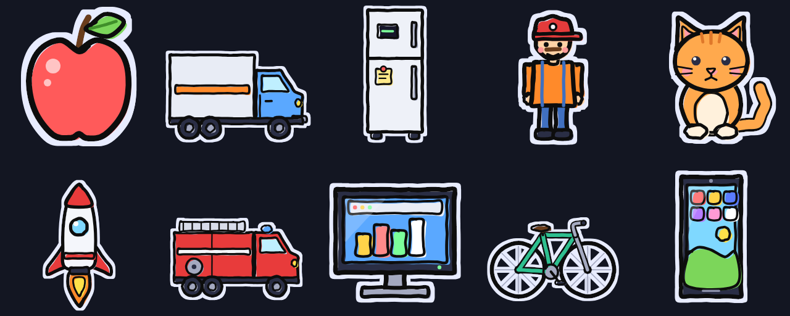

# Handdrawn Sticker Creator

跟 AI 說你要什麼圖，把它回的 JSON 貼進來，就得到一張手繪貼紙風格的透明 PNG。

**線上版：** https://asd890303.github.io/handdrawn-sticker-creator/

粗黑外框、塗出線的填色、白色貼紙描邊都由工具加上。輸出是乾淨去背的透明 PNG，沒有投影或背景。AI 只描述形狀和顏色，任何聊天型 AI 都寫得出來，你不用會畫圖或寫程式。

## 產生一張圖

1. 打開線上版，按右上角「AI 規格」，再按「複製全部」。也可以直接複製 [docs/ai-prompt.md](docs/ai-prompt.md) (繁體中文) 或 [docs/ai-prompt.en.md](docs/ai-prompt.en.md) (English) 的全文。網頁切換成 English 時，視窗裡也會顯示英文版。
2. 整份貼給任何 AI 並送出。AI 會先問你要畫什麼，回答例如「側面的紅色消防車」。沒想法就回「隨機」，它會自己挑一個題材。
3. 在線上版按左下「新增」，取個名字，把 AI 回的 JSON 貼進編輯區。
4. 按右下角「下載 PNG」。

AI 寫錯時，編輯區下方會列出哪個欄位有問題。把錯誤訊息貼回給 AI，請它修正。

左邊「圖片列表」一開始有蘋果、卡車、冰箱、卡車司機、小貓、火箭、消防車、螢幕、腳踏車、手機十張範例，可以直接點來看。

## 人形繪圖 (Beta)

編輯畫面左上角可以切換「貼紙」和「人形」。切到人形，左邊列表換成人形角色，中間仍是 JSON，右邊是 SVG 預覽，下載照舊。

人形的 JSON 為四個部位 (腿、手臂、身體、頭) 各寫一組貼紙圖形，和貼紙用同一套圖形 (`poly`、`ell`、`line`、`dot` 等)。工具固定處理骨架和動作，把這些部位擺到正面、背面、側面各 6 格的走路畫面上，共 18 格，排成 768×384 的透明 PNG 圖集，每格 128、共 6 欄 3 列。向左用向右翻轉。只有走路，沒有受傷、衝刺、死亡動作、配件和腳底光暈。人物下半身有淡淡陰影，畫在圖裡面，外面仍是透明；JSON 寫 `"shade": false` 可以關掉。

1. 切到「人形」，按「AI 規格」，再按「複製全部」，整份貼給任何 AI。
2. 回答角色的樣子，按「新增」，把 AI 回的 JSON 貼進編輯區。
3. 預覽出現 18 格後，按「下載 PNG」。

AI 的回覆長度就是你的 token 花費，所以人形 JSON 有三個省字寫法，畫出的結果和完整寫法相同：

- 腿、手臂、身體的 `back` 省略時沿用 `front`。
- `poly`、`dot`、`line` 有人形專用的預設值。
- 常用圖形可以寫成陣列。

規格文件要求 AI 把回覆壓成單行、3000 字元以內。AI 在 JSON 前後加了說明文字或程式碼框時，貼上會自動去掉，你不用再問一次。

列表一開始有四個範例角色，可以直接複製改。每個角色的形狀由自己的 JSON 決定，所以同一副骨架可以畫出不同體型和髮型，風格仍然一致。在 coding agent 裡使用，可以安裝 `skills/handdrawn-humanoid/`，它由 `npm run skill` 從規格文件產生。規格文件是 [docs/humanoid-prompt.md](docs/humanoid-prompt.md) ([English](docs/humanoid-prompt.en.md))。程式在 `src/humanoid.js`。

## 常見問題

**我的圖會上傳到哪裡嗎？**
不會。繪圖都在你的瀏覽器裡完成，JSON 和圖片都不會送出去。

**關掉網頁後，圖還在嗎？**
在。圖片列表裡的每張圖都邊改邊存在你的瀏覽器裡，最多 100 張。換電腦、換瀏覽器或用無痕模式就看不到，重要的圖請按「下載 JSON」另存。

## 文件

| 文件 | 給誰看 |
|---|---|
| [docs/ai-prompt.md](docs/ai-prompt.md) | 給 AI 的完整規格。整份貼給 AI 送出，它會先問你要畫什麼 |
| [docs/ai-prompt.en.md](docs/ai-prompt.en.md) | 同上，英文版 (English version of the AI spec) |
| [docs/humanoid-prompt.md](docs/humanoid-prompt.md) | 人形繪圖 (Beta) 給 AI 的規格。整份貼給 AI 送出，它會問你角色的樣子 |
| [docs/humanoid-prompt.en.md](docs/humanoid-prompt.en.md) | 同上，英文版 |
| [docs/architecture.md](docs/architecture.md) | 想了解手繪效果原理、安全設計的人 |

## 授權

[MIT](LICENSE)
